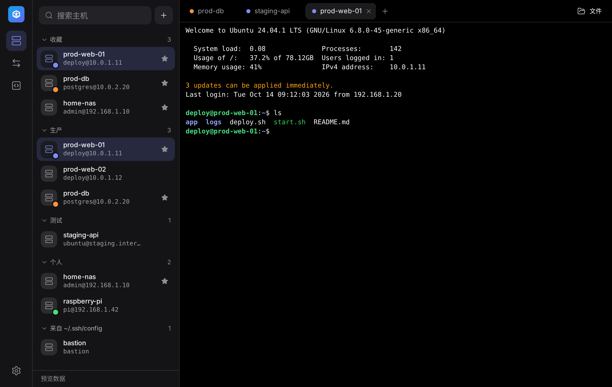
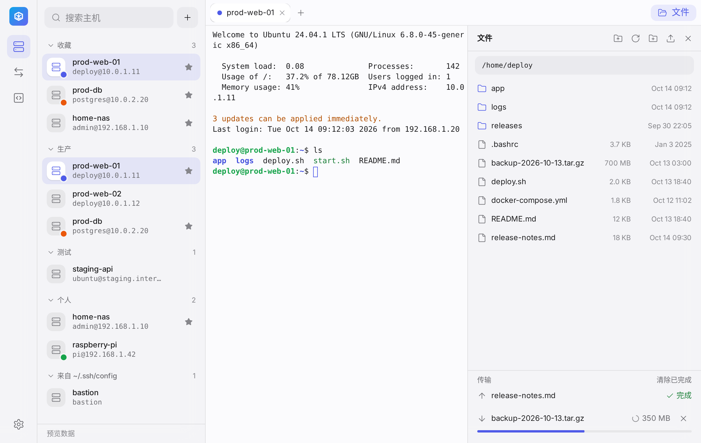
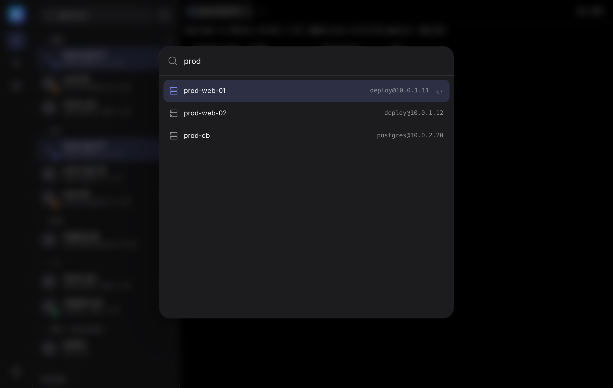
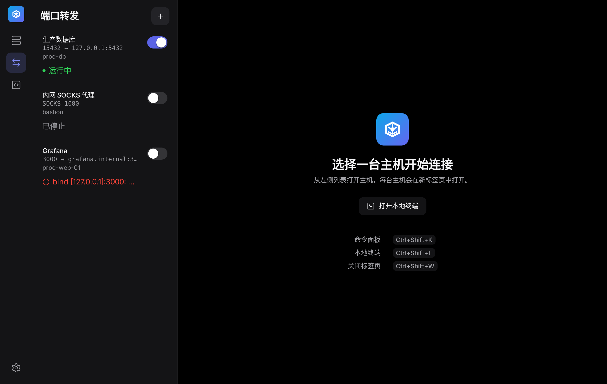
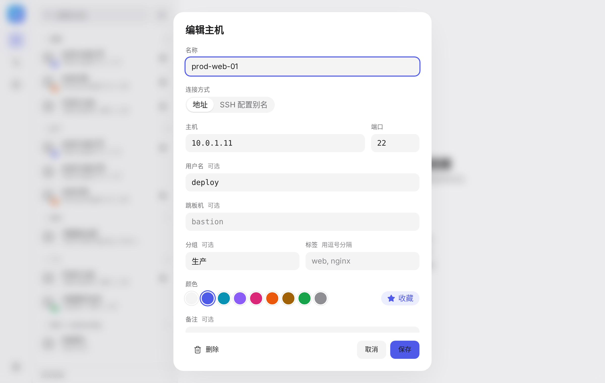

# AnixOps SSH

A clean, Termius-style SSH client for the OpenSSH already on your computer.
Hosts on the left, sessions in tabs, files beside the terminal, and nothing
you do not need.

[中文使用指南](docs/guide.zh-CN.md) · [Download](https://github.com/AnixOps/EasySSH/releases/latest) · [Try the UI in a browser](https://anixops.github.io/EasySSH/) (sample data, no connections)



## Why another SSH client

AnixOps SSH never implements the SSH protocol and never stores passwords or
private keys. Every session runs your own `ssh`, so `~/.ssh/config`,
`ProxyJump`, `known_hosts`, the system SSH agent and the 1Password SSH agent
work exactly as they do in your terminal. The app adds the parts a terminal
lacks: an organised host list, tabs, a file pane, snippets and tunnels.

## Features

| | |
|---|---|
| **Hosts** | Saved hosts and every `Host` in `~/.ssh/config`, grouped, tagged, coloured and searchable. Create and edit hosts in the app. |
| **Terminal** | xterm.js tabs on a real PTY: truecolor, 10,000-line scrollback (adjustable), find, copy and paste, reconnect, local shell tabs. |
| **Files** | An SFTP pane beside the terminal: browse, upload by drag and drop, download, rename, delete, with a transfer queue. |
| **Passwords** | Terminals ask in the terminal. The file pane and tunnels ask in a dialog through `SSH_ASKPASS`; answers go straight to OpenSSH and are never saved. |
| **Snippets** | Saved commands, run in the active terminal or broadcast to all. |
| **Tunnels** | Local, remote and SOCKS forwards, one switch each, with live status. |
| **Command palette** | Hosts, snippets, tunnels and actions in one search box. |
| **Backup and sync** | Export and import hosts, or keep them in a Git repository. Never includes passwords or keys. |
| **Design** | [AnixOps Design](https://github.com/AnixOps/AnixOps-design): light, dark or system theme; Chinese and English. |

<table>
  <tr>
    <td></td>
    <td></td>
  </tr>
  <tr>
    <td></td>
    <td></td>
  </tr>
</table>

## Install

Download the installer for your platform from
[Releases](https://github.com/AnixOps/EasySSH/releases/latest):
`.exe` for Windows, `.dmg` for macOS (Apple silicon), `.deb` or `.AppImage`
for Linux.

The installers are not signed yet. On Windows choose **More info → Run
anyway** in SmartScreen; on macOS right-click the app and choose **Open** the
first time.

You need the OpenSSH client (`ssh`, `sftp`). macOS and Linux desktops include
it; on Windows 10 and 11 it is under **Settings → System → Optional
features → OpenSSH Client**. The app checks this on start and in Settings.

## Shortcuts

| Action | Windows and Linux | macOS |
|---|---|---|
| Command palette | Ctrl+Shift+K | ⌘K |
| New local terminal | Ctrl+Shift+T | ⌘T |
| Close tab | Ctrl+Shift+W | ⌘W |
| File pane | Ctrl+Shift+E | ⌘E |
| Find in terminal | Ctrl+Shift+F | ⌘F |
| Copy and paste | Ctrl+Shift+C / V | ⌘C / ⌘V |

App shortcuts use Ctrl+Shift so that Ctrl+W, Ctrl+K and friends still reach
the shell.

## Security boundary

- Host metadata lives in a local JSON file in the OS configuration
  directory. Fields that look like secrets are rejected on load and save.
- The frontend only receives display data. Every `ssh`, `sftp` and tunnel
  command is built and validated in `easyssh-core`; values that could become
  extra options or commands are rejected.
- `SSH_ASKPASS` prompts reach the app over a loopback socket guarded by a
  random token. Answers are passed to OpenSSH and dropped.
- Export files and Git sync carry hosts, groups, snippets and tunnels only.
  Git authentication is left to the system `git`.

## Development

```bash
npm install
npm run dev          # the UI in a browser with preview data
npm run tauri dev    # the desktop app (needs Rust and the Tauri prerequisites)
```

| Layer | Choice |
|---|---|
| Shell | [Tauri 2](https://tauri.app) |
| UI | React, Tailwind CSS v4, shadcn/ui, AnixOps Design tokens |
| Terminal | xterm.js on a PTY (portable-pty, ConPTY on Windows) |
| Core | `crates/easyssh-core`: OpenSSH invocation and validation, sftp, tunnels, config, sync |

CI builds and tests every push on Windows, macOS and Linux, captures UI
screenshots in light and dark, and publishes installers when a `v*` tag is
pushed. See [AGENTS.md](AGENTS.md) for how changes are made,
[RELEASING.md](RELEASING.md) for how versions ship, and
[ROADMAP.md](ROADMAP.md) for what is planned.

## License

MIT. The AnixOps mark, wordmark and icons are covered by the AnixOps brand
license in the design repository.
