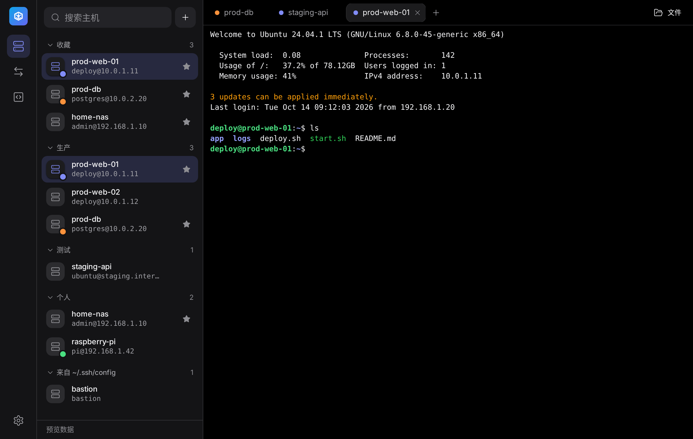
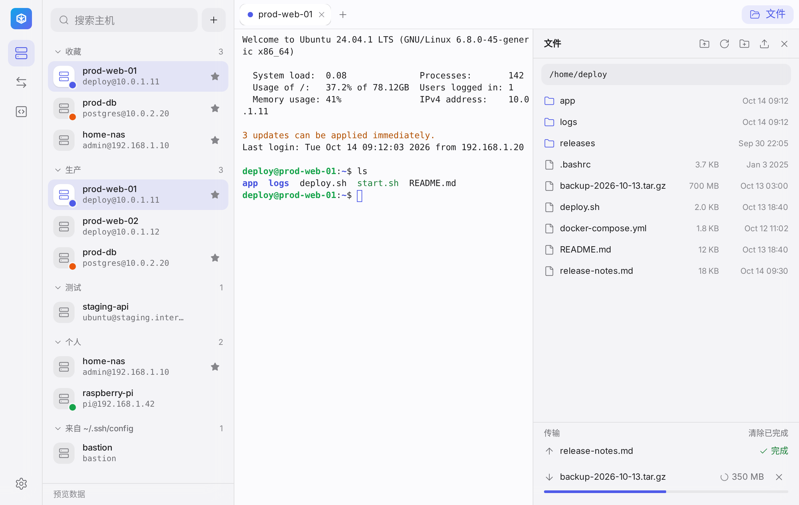
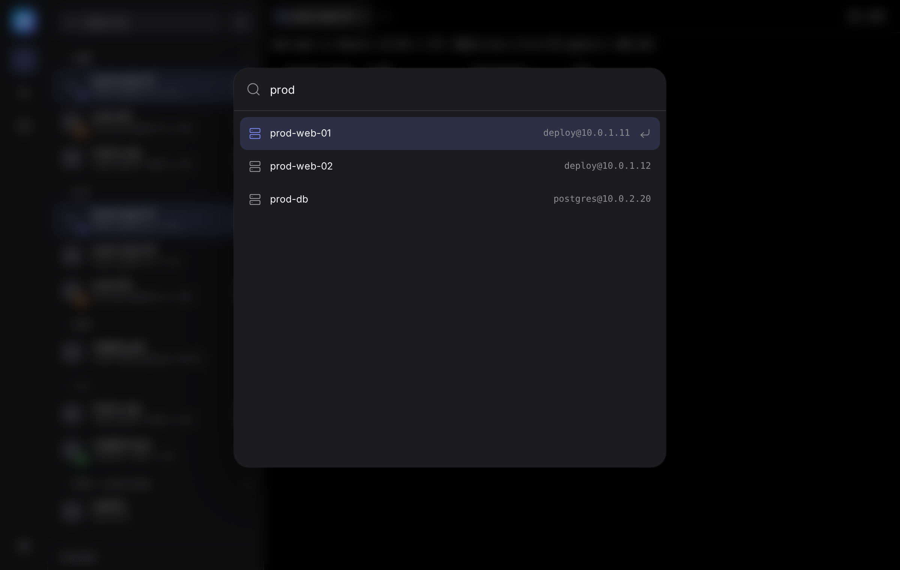
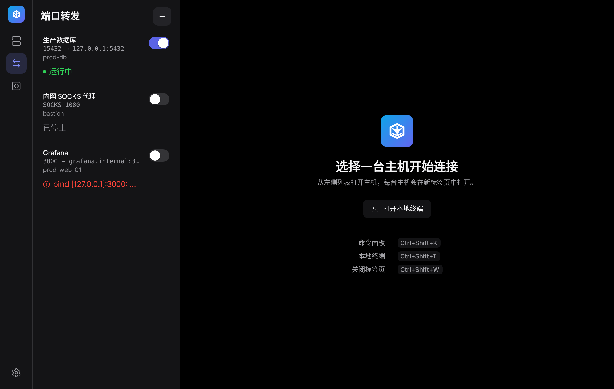
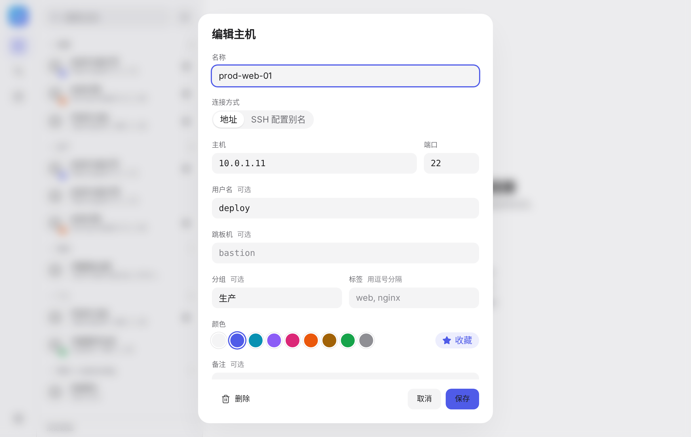

<picture>
  <source media="(prefers-color-scheme: dark)" srcset="docs/brand/readme-banner-ssh-dark.png">
  
</picture>

# AnixOps SSH

A clean, Termius-style SSH client for the OpenSSH already on your computer.
Hosts on the left, sessions in tabs, files beside the terminal, and nothing
you do not need.

[中文使用指南](docs/guide.zh-CN.md) · [Download](https://github.com/AnixOps/EasySSH/releases/latest) · [Try the UI in a browser](https://anixops.github.io/EasySSH/) (sample data, no connections)



## Why another SSH client

AnixOps SSH never implements the SSH protocol. Every session runs your own
`ssh` (passwords and keys are optional and stay encrypted, see
[Security boundary](#security-boundary)), so `~/.ssh/config`,
`ProxyJump`, `known_hosts`, the system SSH agent and the 1Password SSH agent
work exactly as they do in your terminal. Hosts can also connect through an outbound SOCKS5 or HTTP CONNECT proxy (built-in engine only; the OpenSSH engine refuses rather than connect directly). The app adds the parts a terminal
lacks: an organised host list, tabs, a file pane, snippets and tunnels.

## Where it is going

Version 2 turns the app into a local-first, end-to-end encrypted home for
hosts, keys and sessions, with an optional open-source sync server for
yourself or a team. The plan is in
[docs/architecture-v2.md](docs/architecture-v2.md) and
[ROADMAP.md](ROADMAP.md). Until it ships, everything below describes the
current 1.x app.

## Features

| | |
|---|---|
| **Hosts** | Saved hosts and every `Host` in `~/.ssh/config`, grouped, tagged, coloured and searchable. Create and edit hosts in the app. |
| **Terminal** | xterm.js tabs on a real PTY: truecolor, 10,000-line scrollback (adjustable), find, copy and paste, reconnect, local shell tabs. |
| **Files** | An SFTP pane beside the terminal: browse, upload by drag and drop, download, rename, delete, with a transfer queue. |
| **Server monitor** | Beside a host's terminal: address, uptime, load, CPU, memory and swap, the busiest processes, network and latency over time, and disks. A full process list sorts by any column and can end a process. It reads `/proc` on the terminal's own connection (Linux servers), never connecting by itself: on the built-in engine through the shared connection, on OpenSSH (Linux, macOS) through the terminal's control socket (`ssh -M -S`, no prompts). On the phone a card over the terminal shows CPU, memory, the root disk, network rate, load and uptime every 3 s while it is open and the app is in front. |
| **SSH engine** | The built-in engine (russh) is the default: a host's terminal, file pane and tunnels share one connection, so a password or key passphrase is asked once. Hosts that need something it does not do (`ProxyCommand`, `Match`, `LocalCommand`, certificates, a remote command, forwards stored in the config; FIDO2 keys too on a Windows without the WebAuthn API) run on the system OpenSSH automatically. OpenSSH is also an advanced choice, globally or per host, in **Settings → Advanced**; it is kept for compatibility and only gets fixes. Installs that never chose an engine use the built-in one; an explicit OpenSSH choice is kept. |
| **Passwords** | The built-in engine asks in a dialog, once per connection. On OpenSSH hosts terminals ask in the terminal, and the file pane and tunnels ask in a dialog through `SSH_ASKPASS`. Answers go straight to the engine and are saved only if you choose "Remember in vault". |
| **Snippets** | Saved commands, run in the active terminal or broadcast to all. |
| **Tunnels** | Local, remote and SOCKS forwards, one switch each, with live status. |
| **Command palette** | Hosts, snippets, tunnels and actions in one search box. |
| **Import from other clients** | Bring in hosts from `~/.ssh/config` (with `Include`), PuTTY, SecureCRT, MobaXterm, Xshell, FinalShell, Termius, Ansible inventories (YAML or INI) or CSV. Review them first, choose a group and what to do with duplicates; nothing you have is removed. Passwords and keys are never imported. |
| **Sync and team vaults** | Keep hosts, groups, snippets, tunnels and known hosts in step across your devices through your own [easyssh-server](crates/easyssh-server/README.md), end-to-end encrypted. Share a vault with a team after comparing safety numbers. See [Sync](#sync-and-team-vaults). |
| **Import from services** | "Import hosts" → "Import from a service" reads the host list of a service you run: AnixOps Control (the approved nodes of the panel, through an admin API token with scope `read`) or JumpServer (the assets of an organization, through a signed access key request; the hosts can connect through JumpServer's KoKo SSH gateway, where you pick the asset in KoKo's menu and answer its password and MFA prompts as usual). The token or key secret is sealed in the vault and only ever sent in a request header, https is required (http only for localhost), and the preview shows what is new and what exists before anything is written. Syncing again updates the hosts it imported (matched by the panel and node id, so a changed address does not duplicate) and lists hosts the panel no longer has without deleting them. See [easyssh-services](crates/easyssh-services/README.md). |
| **Backup** | Export and import hosts, or back them up to a Git repository. Never includes passwords or keys. |
| **Ask AI** | Off by default. Bring your own key for Anthropic, an OpenAI-compatible endpoint or local Ollama; the key lives in the vault and requests are made by the app's Rust side, so the key never reaches the web view. A side panel per terminal lets you tick what to share (last command and output, selection, last lines), shows secrets it removed and the exact request, and sends nothing until you press Send. Suggested commands can be inserted on the input line, never run. |
| **Updates** | Desktop builds that carry the project's update key check once a day (Settings → Updates, can be turned off) whether a newer release exists; a dot on Settings says so. "Update and restart" downloads the installer, verifies its size, SHA-256 and signature, installs it and starts the new version: on Windows the installer runs in passive mode and reopens the app (running terminals disconnect), on macOS the app replaces itself and reopens, and on Linux the AppImage replaces itself; open sessions are kept on macOS and Linux. A `.deb` installation is updated with the package manager; the app opens the release page. The release feed and every installer are signed (Ed25519, `anixops-appcast-v1` of [anix-kit](https://github.com/AnixOps/anix-kit)) and checked against a key compiled into the app; a file that does not verify is deleted, never opened. Without that key the app never checks. See [Privacy](#privacy). |
| **Session logs** | Optional per host, with a default in Settings. Terminal output is written encrypted (XChaCha20-Poly1305, a key derived per log from the vault device key) to `logs/<host>/<time>.esl` in the data directory. View a log read-only with search, export it as plain text after confirming, delete it, or let retention (30 days by default) clean up. Needs an unlocked vault. |
| **Design** | [AnixOps Design](https://github.com/AnixOps/AnixOps-design): light, dark or system theme; Chinese and English. |

<table>
  <tr>
    <td></td>
    <td></td>
  </tr>
  <tr>
    <td></td>
    <td></td>
  </tr>
</table>

## Install

Download the installer for your platform from
[Releases](https://github.com/AnixOps/EasySSH/releases/latest):
`.exe` for Windows, `.dmg` for macOS (Apple silicon), `.deb` or `.AppImage`
for Linux.

The installers are not signed yet. On Windows choose **More info → Run
anyway** in SmartScreen; on macOS right-click the app and choose **Open** the
first time.

The built-in engine needs nothing else for most hosts. Keep the OpenSSH client
(`ssh`, `sftp`) installed for hosts that fall back to it and for local
`~/.ssh/config` parsing. macOS and Linux desktops include it; on Windows 10 and
11 it is under **Settings → System → Optional features → OpenSSH Client**. The
app checks this on start and in Settings.

## Shortcuts

| Action | Windows and Linux | macOS |
|---|---|---|
| Command palette | Ctrl+Shift+K | ⌘⇧K (⌘K outside a terminal) |
| Clear screen and scrollback | | ⌘K |
| New local terminal | Ctrl+Shift+T | ⌘T |
| Close tab | Ctrl+Shift+W | ⌘W |
| File pane | Ctrl+Shift+E | ⌘E |
| Find in terminal | Ctrl+Shift+F | ⌘F |
| Copy and paste | Ctrl+Shift+C / V | ⌘C / ⌘V |
| Split right | Ctrl+Shift+D | ⌘D |
| Split down | Ctrl+Shift+O | ⌘⇧D |
| Focus pane | Ctrl+Shift+Arrow | ⌘⌥Arrow |
| Maximise or restore pane | Ctrl+Shift+Enter | ⌘⇧Enter |
| Broadcast input to this tab | Ctrl+Shift+B | ⌘⇧B |
| Previous / next prompt (needs shell integration) | Ctrl+Shift+PageUp / PageDown | ⌘↑ / ⌘↓ |
| Show all shortcuts | Ctrl+/ (Ctrl+Shift+/ in a terminal) | ⌘/ |

Close tab closes the focused pane first; the last pane closes the tab.
Broadcasting to all tabs is in the tab bar, the snippets panel and the command
palette. Pasting text with a newline while broadcasting asks first. Drag a
divider to resize panes, or focus it and use the arrow keys (Shift for bigger
steps, Enter to centre).

App shortcuts use Ctrl+Shift so that Ctrl+W, Ctrl+K and friends still reach
the shell. Ctrl+Shift+Arrow is already pane focus, so the prompt jumps use the
page keys on Windows and Linux; ⌘↑ and ⌘↓ are free on macOS.

## Shell integration

Per host, off by default (**Shell integration** in the host editor). When it is
on, EasySSH sends a small script to the remote bash, zsh or fish after login
(nothing is written on the host, and it is not added to the shell history). The
shell then reports prompts, the exact command line, exit codes and the working
directory through our own escape sequence. The terminal uses it for exact
completion with relative paths, a margin bar per prompt (green when the command
succeeded, red when it failed, hover for the command and exit code), and the
prompt jumps above. What the scripts do and the sequence format are in
[`shell-integration/README.md`](shell-integration/README.md).

## rz/sz in the terminal

Run `sz file` on the host and the app asks nothing more than where to put it
(the Downloads folder, or a Save dialog when **Ask where to save received
files** is on); run `rz` and a file picker (several files at once) opens. A
card over the terminal shows progress; Esc or Ctrl+C cancels and sends the
ZMODEM abort sequence. Nothing of the transfer is written to the screen. It
is on by default (**Settings → Terminal → rz/sz file transfer**) and on the
desktop app only. The protocol is [zmodem.js](https://github.com/FGasper/zmodemjs)
(Apache-2.0, a permissive licence compatible with this project's MIT); terminal
output reaches the web view without losing a byte (bytes that are not UTF-8 are
carried as private-use characters U+100080 to U+1000FF and turned back for the
transfer). trzsz is not supported yet.

## Security boundary

- Hosts, groups, snippets, tunnels, settings and known host keys live in a
  local SQLite database (`easyssh.db`) in the OS configuration directory. The
  first start of 2.0 migrates the v1 `connections.json` into it and keeps a
  copy as `connections.v1-backup.json`. Fields that look like secrets are
  rejected when reading the v1 file.
- **Saved passwords, private keys and key passphrases are optional** and are
  stored only encrypted (XChaCha20-Poly1305) in the `host_secrets` table, with
  keys only you hold. The encryption key is a random 32-byte device key in the
  OS keychain (Keychain, Credential Manager or Secret Service). The record id
  and field are bound into every ciphertext, so a value cannot be moved to
  another host or field. Plaintext is never written to disk or to logs and is
  zeroized in memory after use. Secrets are never exported, never put in Git
  sync and never leave the machine.
- **Without a vault passphrase the vault is protected by the OS keychain
  only**: any program running as you that can read your keychain can read the
  device key. Settings › Security lets you set a vault passphrase (Argon2id)
  that wraps the device key; the raw key is then removed from the keychain,
  you unlock once per run when a saved secret is first needed, can lock at any
  time, and the vault locks itself after 15 idle minutes (configurable).
  "Forget all saved secrets" deletes every stored secret. A forgotten vault
  passphrase cannot be recovered.
- Saved secrets are used only for the exact host and user they belong to. The
  askpass helper answers only password and key passphrase prompts and never
  host key questions or any other prompt. On the built-in engine a saved
  private key and its passphrase are handed to the engine from memory and are
  never written to disk. On OpenSSH a saved private key is written to a `0600`
  file in the runtime directory for the life of the `ssh` process and deleted
  afterwards (and swept on daemon start).
- Host keys the built-in engine trusts live in the app database (so they sync
  with a vault), with `~/.ssh/known_hosts` read as a fallback and never
  written. A key that differs from the recorded one is refused until you
  replace it on purpose. The file earlier builds kept is imported once.
- Windows Hello (Windows) and Touch ID (macOS) can unlock the vault, opt-in
  from Settings, Vault, and shown only where the device supports them. The
  passphrase always remains a fallback. The device key stays in the OS keychain
  and the biometric prompt gates the read; this is a convenience gate, not a
  hardware boundary. Linux has no biometric provider.
- FIDO2 security keys with the `hmac-secret` extension can unlock the vault too, on
  Linux, macOS (USB) and Windows 11. In Settings, Vault, "Add security key" asks for the
  vault passphrase once and then for two touches (and the key's PIN if it has one); up to
  four keys can be added and each removed on its own. Unlike Touch ID and Windows Hello,
  the stored copy of the key cannot be opened without the security key. The passphrase
  always remains a fallback. The option is shown disabled where the system cannot do it.
- FIDO2 security keys (`sk-ssh-ed25519@openssh.com`, `sk-ecdsa-sha2-nistp256@openssh.com`)
  log in on the built-in engine on Linux and macOS: add the key file (the one
  `ssh-keygen -t ed25519-sk` wrote; it holds a handle, not a secret) as an identity file or
  save it in the host's vault entry. The app asks you to touch the key, and for its PIN when
  the key needs one; the PIN is never saved or logged. USB keys that speak CTAP2 are
  supported; the app talks to them directly and needs no libfido2. On Linux the user needs
  access to the key's hidraw device (the udev rules that come with most distributions'
  `libfido2`/`u2f-host` packages grant it). On Windows the app uses the Windows WebAuthn API
  (`webauthn.dll`, Windows 10 1903 or later), the same route as OpenSSH for Windows, because
  only elevated processes may open FIDO devices directly: Windows shows its own dialog for the
  touch and the PIN, and the app only shows a notice. Both `sk-ssh-ed25519@openssh.com` and
  `sk-ecdsa-sha2-nistp256@openssh.com` keys are meant to work and servers see ordinary sk
  signatures, so no server setting is needed; Ed25519 also needs a key and a Windows build that
  support it. A Windows without the API keeps using the system OpenSSH for these hosts. The
  Windows prompt itself cannot run in CI (it needs a person and a key): CI builds the Windows
  backend and tests the signature assembly, but a real key has not been exercised by the
  automated checks.
- Serial ports are a session type: add a serial connection from the plus menu
  (port, baud, data bits, parity, stop bits, flow control). Output goes through
  the same terminal path as SSH, so scrollback and recording work. On Linux,
  add your user to the `dialout` (or `uucp`) group to open ports.
- The frontend only receives display data. Every `ssh`, `sftp` and tunnel
  command is built and validated in `easyssh-core`; values that could become
  extra options or commands are rejected.
- `SSH_ASKPASS` prompts reach the app over a loopback socket guarded by a
  random token. Answers are passed to OpenSSH and dropped.
- Export files and the Git backup carry hosts, groups, snippets and tunnels
  only. Git authentication is left to the system `git`.
- Sync never carries saved passwords, private keys or key passphrases (they
  stay in the local vault), and the server only ever holds ciphertext. See
  [Sync and team vaults](#sync-and-team-vaults).

## Sync and team vaults

Settings › Sync connects the app to an `easyssh-server` that you run (see
[crates/easyssh-server](crates/easyssh-server/README.md)). The server URL must
be `https`; plain `http` is accepted only for this machine, for testing.

- **Sign up or sign in** with a server URL, an account name and an account
  passphrase. The passphrase is stretched with Argon2id on this device and
  never sent or stored. The account keys and the session token are kept
  encrypted with the vault's device key, so you do not type it again. If you
  forget the passphrase the data cannot be recovered.
- **What syncs**: hosts, groups, snippets, tunnels and known hosts. Every
  record is encrypted before it leaves the device and signed by the device.
  Two devices that edit different fields of one host are merged field by
  field; if both change the same field, the later edit wins and the other
  value stays in the host's **History** (host editor), where **Restore** puts
  it back as an ordinary edit.
- **What never syncs**: saved passwords, private keys, key passphrases and
  secret notes.
- **When**: on start, two minutes apart, and shortly after a local change.
  **Sync now** runs one at once. The status line shows the last success and the
  last error. A revoked device (Settings › Sync › Devices) can no longer sync;
  what it wrote before is kept.
- **Team vaults** (the people icon in the sidebar): create a shared vault, add
  members as owner, editor or viewer, and move hosts into it from the host
  editor. Before someone is added you both read the **safety number** (twelve
  groups of five digits derived from their public keys); add them only when the
  numbers are identical, over a channel you trust. If their keys later change
  the member is shown as "Keys changed".
- **Removing a member** replaces the vault key and re-encrypts the whole
  vault: they keep only what they had already synced and cannot read anything
  newer. Only an owner can do it, and it can take a moment in a big vault.
- **Known limits**: a new device needs the account passphrase. When a token has
  expired you sign in again.
- **Backup to Git** (Settings › Backup) is the former Git sync, kept as an
  export and import target. It is not a sync channel.

## Privacy

Nothing about you leaves your machine unless you say so; the one exception
is the identifier-free update check below. On first start the app asks
once whether it may send **crash reports**; **anonymous usage statistics** are
off until you turn them on in Settings › Privacy. Both can be changed or
turned off at any time, and a build without a configured server (the default
when you build it yourself) collects and sends nothing.

- Crash reports: app version, OS, CPU architecture, the panic or error
  message and the function names of the call stack, with host names, IP
  addresses, e-mail addresses, `user@host`, home-directory paths and long
  tokens removed. They are written to a local folder first, uploaded on the
  next start, and "View pending reports" shows the exact bytes before that.
  The server is a self-hosted GlitchTip.
- Usage statistics, once a day: `app_version`, `os`, `arch`, `engine`,
  `hosts` (0, 1-5, 6-20 or 21+) and `sessions` (same buckets). No identifier.
- Never collected: terminal content, host names, addresses, user names, file
  paths, command lines, keys or passwords.

Details and how to self-host the server: [docs/telemetry.md](docs/telemetry.md).

**Update check** (desktop builds with the project's update key only; on by
default, Settings → Updates). Once a day at start-up, and when you press
"Check now", the app sends one plain HTTPS `GET` to
`https://github.com/AnixOps/EasySSH/releases/latest/download/anixops-ssh-<os>.appcast.json`
(redirects are followed only to `github.com`, `objects.githubusercontent.com`
and `release-assets.githubusercontent.com`). The request carries no cookie,
account, device or install identifier and no statistics; only the standard
HTTP and TLS metadata that any request has (your IP address, which GitHub sees)
and a `User-Agent` of `easyssh-update/<version>`. The answer is verified against
the key built into the app, and the last accepted feed number and the time of
the last check are kept in a local file (`<local data dir>/EasySSH/update.json`).
Nothing is downloaded until you press "Update and restart"; that downloads the
installer named by the verified feed from the same GitHub hosts, with the same
plain request, into `<local data dir>/EasySSH/updates` (next to the AppImage on
Linux), and opens it only after it verifies. The phone apps never check; the
stores update them.

## Development

```bash
npm install
npm run dev          # the UI in a browser with preview data
npm run tauri dev    # the desktop app (needs Rust and the Tauri prerequisites)
```

| Layer | Choice |
|---|---|
| Shell | [Tauri 2](https://tauri.app) |
| UI | React, Tailwind CSS v4, shadcn/ui, AnixOps Design tokens |
| Terminal | xterm.js on a PTY (portable-pty, ConPTY on Windows) |
| Core | `crates/easyssh-core`: OpenSSH invocation and validation, sftp, tunnels, config, sync |

CI builds and tests every push on Windows, macOS and Linux, captures UI
screenshots in light and dark, and publishes installers when a `v*` tag is
pushed. See [AGENTS.md](AGENTS.md) for how changes are made,
[RELEASING.md](RELEASING.md) for how versions ship, and
[ROADMAP.md](ROADMAP.md) for what is planned.

## License

MIT. The AnixOps mark, wordmark and icons are covered by the AnixOps brand
license in the design repository.
