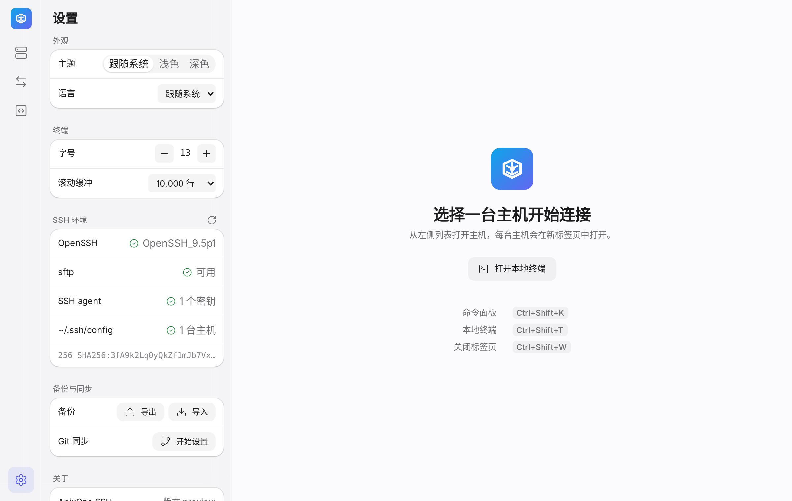

# AnixOps SSH 使用指南

AnixOps SSH 是一个 Termius 风格的 SSH 客户端，背后运行的是你电脑上自带的 OpenSSH。
它不自己实现 SSH 协议，也不保存密码和私钥；`~/.ssh/config`、跳板机、`known_hosts`、
系统 SSH agent 和 1Password SSH agent 都和在终端里用时一模一样。

## 安装

到 [Releases](https://github.com/AnixOps/EasySSH/releases/latest) 下载对应平台的安装包：
Windows 用 `.exe`，macOS（Apple 芯片）用 `.dmg`，Linux 用 `.deb` 或 `.AppImage`。

安装包暂未签名：Windows 首次运行时在 SmartScreen 里点“更多信息 → 仍要运行”；
macOS 首次打开请右键应用选择“打开”。

需要系统装有 OpenSSH 客户端（`ssh`、`sftp`）。macOS 和常见 Linux 桌面自带；
Windows 10/11 在“设置 → 系统 → 可选功能 → 添加 OpenSSH 客户端”。应用启动时和设置页里会检查。

## 主机

- 左侧列表包括你保存的主机，以及 `~/.ssh/config` 里的每个 `Host`。
- 点 **+** 新建主机：可以填地址、端口、用户名，或直接用 SSH 配置里的别名；还能设跳板机、分组、标签、颜色和备注。
- 鼠标移到主机上会出现编辑和收藏按钮；`~/.ssh/config` 里的主机可以“保存到主机列表”后再编辑。

## 终端

- 点一台主机就在新标签页打开终端；已经打开的会直接切过去。
- `Ctrl+Shift+T` 打开本地终端（Windows 上优先用 PowerShell 7）。
- 复制粘贴 `Ctrl+Shift+C / V`，查找 `Ctrl+Shift+F`。字号和滚动缓冲在设置里调。
- 连接断开后，底部会出现“重新连接”和“在系统终端中打开”。
- 应用快捷键都带 Shift（macOS 用 ⌘），所以 `Ctrl+W`、`Ctrl+K` 这些仍然交给 shell。

## 文件

在主机标签页点右上角“文件”或按 `Ctrl+Shift+E`，终端右侧会打开 SFTP 面板：

- 双击文件夹进入，双击文件下载到“下载”文件夹；
- 把文件拖进面板上传，或点上传按钮选择；
- 鼠标移到文件上可以下载、重命名、删除（删除需要确认）；
- 底部的传输队列显示进度，可以取消，下载完成后能“在文件夹中显示”。

## 密码

- 终端里的密码就在终端里输入，和平时一样。
- 文件面板和端口转发没有终端，需要密码、密钥口令或确认主机指纹时会弹出对话框。
  输入的内容直接交给 OpenSSH，**不会保存**，只用于这一次连接。

## 命令片段

左侧图标栏的“命令片段”：把常用命令存下来，点一下就在当前终端执行；
鼠标移上去可以只粘贴不执行。打开底部的开关，可以一次发到所有已连接的终端。

## 端口转发

左侧图标栏的“端口转发”：

- **本地**（`ssh -L`）：本机端口 → 从服务器能访问到的目标，常用于连远程数据库；
- **远程**（`ssh -R`）：服务器端口 → 从本机能访问到的目标；
- **SOCKS**（`ssh -D`）：本机 SOCKS 代理，流量经服务器转发。

每条隧道一个开关。本地和 SOCKS 隧道在本机端口真正可连接后才显示“运行中”；
失败时会显示 ssh 的原始报错。退出应用时所有隧道都会停止。

## 命令面板

按 `Ctrl+Shift+K`（macOS 为 `⌘K`），在一个搜索框里找主机、命令片段、隧道和常用操作，回车执行。

## 设置、备份与同步

- 主题（跟随系统 / 浅色 / 深色）、语言、终端字号和滚动缓冲；
- SSH 环境检查：OpenSSH 版本、sftp、SSH agent 里的密钥、`~/.ssh/config` 主机数；
- **导出 / 导入**：把主机、分组、命令片段和隧道存成一个 JSON 文件，导入时按 ID 合并；
- **Git 同步**：选一个本地文件夹作为仓库（可填远程地址），之后可以推送和拉取。
  拉取会用仓库内容替换本机列表，执行前会确认。认证交给系统的 git。

导出文件和同步内容都不包含密码和密钥。

## 快捷键

| 操作 | Windows / Linux | macOS |
|---|---|---|
| 命令面板 | Ctrl+Shift+K | ⌘K |
| 本地终端 | Ctrl+Shift+T | ⌘T |
| 关闭标签页 | Ctrl+Shift+W | ⌘W |
| 文件面板 | Ctrl+Shift+E | ⌘E |
| 终端内查找 | Ctrl+Shift+F | ⌘F |
| 复制 / 粘贴 | Ctrl+Shift+C / V | ⌘C / ⌘V |

## 遇到问题

到 [Issues](https://github.com/AnixOps/EasySSH/issues) 反馈，附上系统版本、`ssh -V` 的输出和出错时的提示。
请不要贴出密码、私钥或完整的服务器地址。
